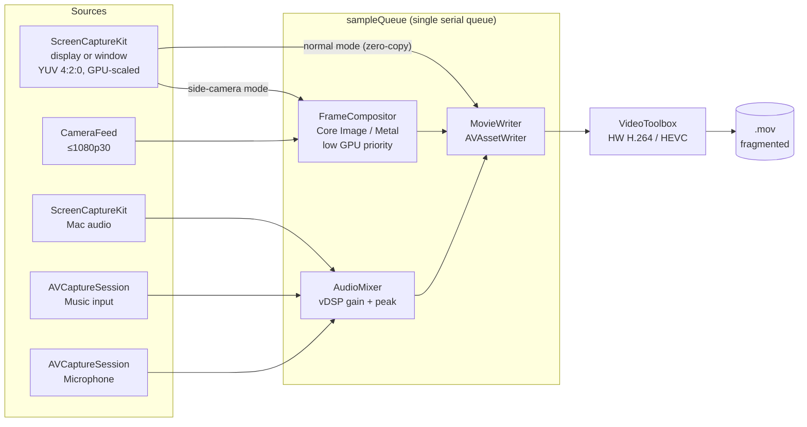

# Architecture

PressStream is a small SwiftUI app around a capture pipeline designed for one goal:
**record high-quality screen + audio + camera while leaving almost all CPU/GPU to the music software.**

## Pipeline

## Key decisions

| Decision | Why |
|---|---|
| `SCStreamConfiguration.pixelFormat = 420v` | Native encoder format, no CPU color conversion |
| `SCStreamConfiguration.width/height` = output size | Scaling happens inside ScreenCaptureKit on the GPU |
| `queueDepth = 4` | Few frames held in memory |
| `AVAssetWriter` (real-time) | Hardware encode through VideoToolbox with very little code |
| Only `.complete` frames are written | A static screen produces no work (variable frame rate) |
| One serial `sampleQueue` for video, audio and composition | No locks, no cross-thread copies |
| Bubble camera = a real floating `NSPanel` | Captured as part of the screen, no composition at all |
| Side camera composed with Core Image on Metal, `priorityRequestLow` | The DAW / DJ app wins GPU contention |
| Compositor renders only when the screen **or** the camera changed | Skips redundant GPU work |
| Composition is driven by a timer at the chosen fps | Camera keeps moving even when the screen is static |
| Audio gain applied in place with vDSP before AAC | Negligible cost, live adjustable |
| Each audio source is its own track | Rebalance in post; no real-time mixing needed |
| All timestamps on the host clock | ScreenCaptureKit, AVCaptureSession and the compositor share one timeline |
| `movieFragmentInterval = 2s` | A crash leaves a playable file |

## Source map

| File | Responsibility |
|---|---|
| `PressStreamApp.swift` | App entry point; `AppDelegate` finishes the file if you quit mid-recording |
| `ContentView.swift` | Main SwiftUI panel and shared UI components |
| `AudioControls.swift` | Volume slider, level meter, audio source row |
| `LayoutPreview.swift` | Mini preview of the side-camera layout with live camera |
| `RecorderEngine.swift` | `@MainActor` view model: state, permissions, device lists, start/stop |
| `CaptureSession.swift` | Owns `SCStream`, audio inputs, compositor timer and the writer |
| `MovieWriter.swift` | `AVAssetWriter` with one video track and one track per audio source |
| `AudioMixer.swift` | `AudioTrack` enum, per-track gain and peak metering |
| `AudioInputCapture.swift` | Captures one audio device as 48 kHz stereo Float32, retimed to host clock |
| `CameraFeed.swift` | Side-mode camera: best format ≤1080p30, keeps latest frame |
| `CameraBubble.swift` | Floating round camera window |
| `FrameCompositor.swift` | Screen + camera composition into an IOSurface-backed pixel buffer pool |
| `RecordingSettings.swift` | Resolution, fps, codec, bitrate, canvas layout math |
| `DeviceCatalog.swift` | Enumerates displays, windows, cameras and audio inputs |

## Threading model

- **Main actor:** `RecorderEngine`, UI, `CameraBubbleController`.
- **`sampleQueue`:** every `SCStream` callback, every audio input callback, the compositor timer and
  all `MovieWriter` calls. Because they share one serial queue, `MovieWriter` needs no locking.
- **`CameraFeed` queue:** camera delivery; the latest frame is handed over under an `NSLock`.
- **`AudioMixer`:** gains are written from the main actor and read on `sampleQueue` under an `NSLock`.

## Layout math

With the side camera on:

- **Fit to source:** the source fills the full output height; the camera strip is `sourceWidth / 3`
  wide, which is exactly 1/4 of the final width. Width is capped at 4096 px (H.264 limit).
- **16:9:** the canvas is fixed (e.g. 1920×1080); the source is aspect-fit into the remaining 3/4,
  which may leave black bars for wide windows.

The camera image is mirrored and aspect-filled (center crop) into its strip.

## Adding streaming (planned)

Replace `AVAssetWriter`'s internal encoder with a `VTCompressionSession` that produces one encoded
stream, then fan it out to both the file muxer and an RTMP/SRT client (e.g. HaishinKit). Encoding
once keeps the media-engine load the same as recording alone.
